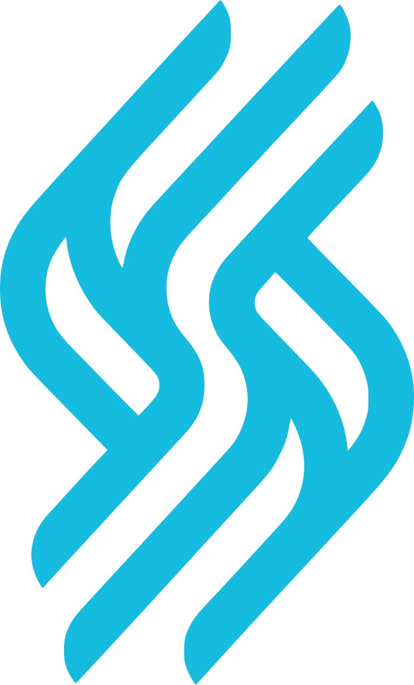

  

<h1 align="center">Sire Run, Inc.</h1>

  Sire Run, Inc. builds Zati, a workspace where owners run a team of AI workers with clear limits, and runs Zati Agency, hands-on AI workshops that help small businesses put AI to work.

  <strong>Zati development lives at <a href="https://github.com/zati-run">github.com/zati-run</a>.</strong>

  <a href="https://sire.run">sire.run</a> ·
  <a href="https://zati.run">zati.run</a> ·
  <a href="https://zati.agency">zati.agency</a> ·
  <a href="https://www.linkedin.com/company/131203918">LinkedIn</a>

Sire, our earlier product, is retired and replaced by Zati.

